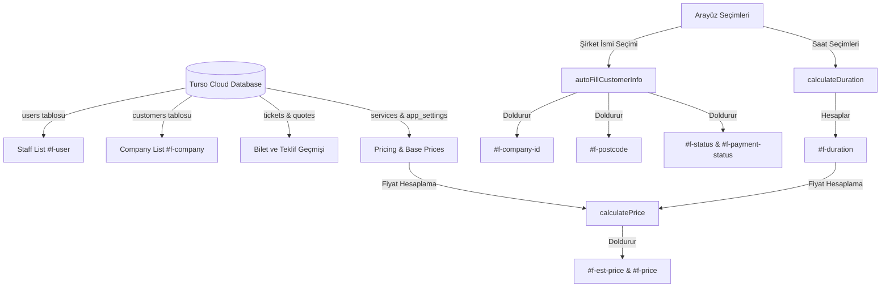

# Yeni Bilet Oluşturma Ekranı ve Veri Akışı Kılavuzu

Bu kılavuz, TaskFlow Portal'daki **"Create New Ticket"** form ekranının yapısını, verilerin kaynaklarını (Turso DB / CRM) ve arkada çalışan dinamik hesaplama ile Antigravity Loop ajan entegrasyonu kurallarını belgelemektedir.

---

## 1. Form Bölümleri ve Alan Tanımları

### A. Administrative Info (Yönetimsel Bilgiler)
*   **Staff (Created By) (`#f-user`):** Bileti oluşturan/ataması yapılan personeli seçer.
*   **Database ID (`#f-db-id`):** Kayıt oluşturulduğunda Turso DB tarafından atanan benzersiz kimlik (Salt okunur).
*   **CRM Ticket No (`#f-crm-ticket`):** Vtiger CRM üzerindeki orijinal bilet numarası.
*   **Timestamp (`#f-timestamp`):** Kaydın oluşturulma tarihi ve saati (Salt okunur).

### B. Client Info (Müşteri Bilgileri)
*   **Customer Number (`#f-company-id`):** Şirket numarası (Salt okunur, otomatik doldurulur).
*   **Company Name (`#f-company`):** Müşteri arama listesinden seçilen şirket adı.
*   **Postcode (`#f-postcode`):** Şirket adresinin posta kodu.
*   **Service Status (`#f-status`):** Şirketin güncel servis sözleşmesi durumu (Salt okunur, otomatik doldurulur).
*   **Address (`#f-address`):** Tam adres (Sokak + Şehir + Posta kodu birleşik, Salt okunur, CRM'den otomatik doldurulur).
*   **Phone Number (`#f-phone`):** Birincil telefon numarası (Salt okunur, CRM'den otomatik doldurulur).
*   **Owner / Member Of (`#f-owner`):** Sahibi veya bağlı olduğu kuruluş (Salt okunur, CRM'den otomatik doldurulur).

### C. Service Category & Details (Hizmet Kategorisi ve Süreleri)
*   **Service Category (`#f-service-type`):** Ana servis türü (`S1` - `S6` arası).
*   **Sub Service (`#f-sub-service`):** Ana servis türüne bağlı dinamik alt hizmet listesi.
*   **Start Time (`#f-start-time`) & End Time (`#f-end-time`):** İşin yapıldığı zaman aralığı.
*   **Duration (min) (`#f-duration`):** Başlangıç ve bitiş saatleri arasındaki dakika farkı (Otomatik hesaplanır).

### D. Payment & Billing (Ödeme ve Faturalandırma)
*   **Service Mode (`#f-payment-status`):** Ödeme tipi (`Chargeable` | `Contract` | `Free`).
*   **Estimated Price (`#f-est-price`):** Sistem tarafından hesaplanan tahmini taban fiyat (Salt okunur).
*   **Final Price (£) (`#f-price`):** Faturalandırılacak nihai ücret (Manuel düzenlenebilir).
*   **Service Number (`#f-invoice-no`):** Hizmet referans numarası (SRV-XXXX) (Salt okunur).
*   **Service Date (`#f-invoice-date`):** Hizmet tarihi (Salt okunur).

---

## 2. Veri Kaynakları ve Akışı (Data Flow)

### Detaylı Veri Kaynakları:
1.  **Personel Listesi:** `appState.settings.personnel` Turso'daki `users` tablosundan çekilir.
2.  **Müşteri Arama Havuzu:** `appState.customers` Turso üzerindeki `customers` tablosunun arayüz tarafında indekslenmesiyle oluşur (Vtiger CRM senkronizasyon scriptiyle güncellenir).
3.  **Bilet ve Teklif Bilgisi:** Turso `tickets` ve `quotes` tablolarındaki ilgili `parent_id` / `account_id` eşleşmesine göre dinamik olarak listelenir.

---

## 3. Dinamik Hesaplama Kuralları

### A. Otomatik Müşteri Bilgisi Doldurma (`autoFillCustomerInfo`)
Bir şirket seçildiğinde tetiklenir:
*   Müşterinin posta kodu ve müşteri numarası otomatik doldurulur.
*   Eğer müşterinin sözleşme durumu **`Contract`** ise:
    *   Sözleşme durumu (`f-status`) yeşil arka planlı ve beyaz yazılı olur.
    *   Ödeme modu (`f-payment-status`) otomatik olarak **`Contract`** seçilir ve yeşil boyanır.
*   Sözleşme yoksa ödeme modu **`Chargeable`** (Ücretli) olur ve stil varsayılana döner.

### B. Süre Hesaplama (`calculateDuration`)
*   Başlangıç ve bitiş saatleri arasındaki fark dakika olarak `#f-duration` alanına yazılır.
*   Eğer başlangıç saeti boşken bitiş saati seçilirse, seçili hizmete göre geriye dönük varsayılan bir başlangıç saati atanır (Örn: S1 için 30 dk geri, diğerleri için 15 dk geri).

### C. Fiyat Hesaplama (`calculatePrice`)
Fiyat hesaplama formülleri ana servis tipine göre belirlenir:
1.  **Ana Hizmet S1 (Menu Update) ise:**
    *   `Sub Service` = **Set Menu** veya **Dessert Menu** ise fiyat sabit Set Menu ücretidir (varsayılan £35.00).
    *   `Sub Service` = **New Menu** ise fiyat sabit £250.00'dır.
    *   Diğer durumlar için taban fiyat (`S1_Base`, varsayılan £125.00) uygulanır.
    *   **Ek Mesai:** Süre 60 dakikayı aşarsa, aşan her saat dilimi için (yukarı yuvarlanarak) saatlik mesai ücreti (`S1_Hourly`, varsayılan £25.00) eklenir.
    *   **Randevusuz İşlem:** Eğer acil/randevusuz kutucuğu (`#f-s1-no-appointment`) işaretliyse fiyata **£25.00 acil servis ek ücreti** yansıtılır.
2.  **Diğer Hizmetler (S2, S3, S4, S5, S6) ise:**
    *   Veritabanındaki servis tanımında belirlenen taban fiyatlar uygulanır (Örn: S2 = £125.00, S3 = £125.00, S4 = £65.00).
3.  **Ödeme Statüsü Kontrolü:**
    *   Ödeme statüsü `Chargeable` ise hesaplanan fiyat `Final Price` alanına yazılır.
    *   Ödeme statüsü `Contract` veya `Free` ise `Final Price` otomatik olarak **`0.00`** yapılır.

---

## 4. Antigravity Loop (İşlem Onay) Entegrasyonu

Bilet onaylama butonuna basıldığında doğrudan veritabanına yazmak yerine işlem Antigravity Loop mekanizmasına devredilir:

1.  **Olay Yayını:** `js/ui.js` üzerindeki form submit yakalayıcı `globalEventBus.publish` ile `ticket_create_requested` olayını fırlatır.
2.  **Ajan Planlama (Planner):**
    *   **Customer Agent:** Müşteri limitleri ve statüsünü doğrular.
    *   **Pricing Agent:** Arayüz fiyat hesaplamasının doğruluğunu teyit eder.
    *   **Ticket Agent:** Turso DB API aracılığıyla kaydı `tickets` tablosuna yazar ve lokal `appState.tickets` listesine ekler.
    *   **Logger Tool:** Yapılan işlemi sistem loglarına geçirir.
3.  **Hata ve Çevrimdışı Yönetimi (Verifier):** Bağlantı kopuksa işlem `antigravity_offline_queue` (localStorage) içine alınarak internet bağlantısı sağlandığında otomatik tamamlanır.
